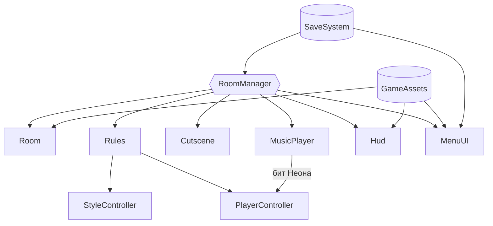

<div align="center">


<h1>RULECRAWL</h1>

<p><b>Пиксельный рогалик, в котором каждая дверь меняет законы игры</b></p>

<p><i>«Каждая дверь — новый закон.»</i></p>

<p>


<a href="https://kyomutenshi.itch.io/rulecrawl"></a>
</p>

<p>
<a href="#об-игре">Об игре</a> ·
<a href="#быстрый-старт">Быстрый старт</a> ·
<a href="#управление">Управление</a> ·
<a href="#сборка">Сборка</a> ·
<a href="#архитектура">Архитектура</a> ·
<a href="#сторонние-ассеты">Ассеты</a>
</p>

</div>

---

## Об игре

За каждой дверью подземелья меняется сам закон игры: механика, цвет, свет и музыка. В одной комнате пол превращается в лаву, в другой стрелять можно только стоя на месте, в третьей двигаться можно только в такт музыке. Три этажа, на каждом свой босс, в конце — Законодатель, который переписывает правила прямо во время боя. Смерть возвращает в самое начало.

```text
Прихожая  →  комнаты этажа (выбор из двух дверей)  →  босс этажа  →  …  →  Законодатель
```

В стенах подземелья спрятаны трещины. За ними — воспоминания из другого мира: квартира человека, который когда-то начал делать игру и так и не смог её закончить. Три воспоминания, три концовки.

> `Roguelike-Prototype` — рабочее название репозитория, а не название игры.

| | |
|---|---|
| **Жанр** | Roguelite, top-down shooter |
| **Движок** | Unity 6 (6000.3.8f1), Universal Render Pipeline 2D |
| **Платформа** | Windows, macOS, браузер |
| **Языки** | Русский, English, 中文, Español |
| **Разработчик** | Piperite Games |
| **Играть** | [kyomutenshi.itch.io/rulecrawl](https://kyomutenshi.itch.io/rulecrawl) |

## Быстрый старт

> Нужны **Unity 6000.3.8f1** (через Unity Hub) и сторонние ассеты из раздела [ниже](#сторонние-ассеты). Без них в сцене не будет спрайтов, эффектов и музыки.

1. Склонируйте репозиторий:
   ```bash
   git clone https://github.com/KyomuTenshi/Roguelike-Prototype.git
   ```
2. Положите каждый пак ассетов в `Assets/_ThirdParty/` под именем папки из таблицы.

   > Сцена ссылается на ассеты по их GUID из `.meta`-файлов, а `.meta` сторонних паков в репозиторий не входят. У заново скачанных паков GUID будут другими, поэтому часть ссылок в сцене (`GameAssets` на объекте `Game`) придётся назначить вручную. Код от этого не зависит и открывается сразу.
3. В Unity Hub нажмите **Add** и выберите папку репозитория.
4. Откройте `Assets/_Project/Scenes/Game.unity` и нажмите **Play**.

## Возможности

- **11 законов.** Склеп, Нуар, Ледяная пещера, Зеркальный зал, Сад пацифиста, Ретро, Лавовый зал, Сокровищница, Перевёрнутая, Неон, Пульт — у каждого своя механика, пост-обработка, свет и музыка.
- **Четыре героя.** Эльф с луком, Рыцарь с мечом, отбивающим снаряды, Волшебница с заряжаемой сферой и телепортом, Ящер с ядовитыми ножами. Трое открываются по ходу игры.
- **Четыре режима.** Забег, Ежедневный (один сид на всех), Хаос (закон меняется каждые 12 секунд) и Бесконечный.
- **Реликвии и комбо.** 16 реликвий, 9 комбинаций из пар реликвий, неизвестные колбы, которые в каждом забеге выглядят по-новому.
- **Проклятия.** Стеклянное сердце, Ярость, Двойной закон, Аскет — сложнее, но больше очков.
- **Процедурные комнаты.** Боевые комнаты собираются заново в каждом забеге и одинаковы для одного сида.
- **Лавка, алтарь и фонтан.** Монеты с врагов, реликвия за сердце, лечение.
- **Неон в такт.** Пять треков с измеренным темпом: герой прыгает ровно на удар музыки.
- **Воспоминания и концовки.** Три тайные комнаты, катсцены на движке и три концовки — их можно пересмотреть в кодексе.
- **Кодекс.** Открытые законы, реликвии, комбо, воспоминания и концовки.
- **Пасхалка.** Классическая комбинация ↑ ↑ ↓ ↓ ← → ← → B A один раз за забег.

## Управление

| Действие | Клавиатура и мышь | Геймпад |
|---|---|---|
| Движение | `W` `A` `S` `D` или стрелки | Левый стик |
| Прицел | Мышь | Правый стик (сразу и атакует) |
| Атака | `ЛКМ` или `Space` | `RT` / `R2` |
| Рывок (если есть) | `Shift` или `ПКМ` | `A` / `✕` или `LT` / `L2` |
| Пауза | `Esc` или `P` | `Start` |
| Полноэкранный режим | `F11` или `Alt + Enter` (на Mac — `Option + Enter`) | — |
| Листать катсцену / пропустить | любая клавиша / `Esc` | `A` / `Start` |

В браузере полноэкранный режим включается кнопкой в правом нижнем углу или в настройках игры.

## Сборка

Сборка — через **File → Build Profiles**, в неё входит одна сцена `Assets/_Project/Scenes/Game.unity`.

| Платформа | Профиль | Что важно |
|---|---|---|
| Windows | Windows, x86_64 | Нужен модуль **Windows Build Support (Mono)** в Unity Hub |
| macOS | macOS, Apple silicon + Intel 64-bit | Приложение не подписано: первый запуск — правый клик → **Открыть** |
| Web | Web | WebGL Template — **RULECRAWL**: игра растягивается на всю страницу, свой экран загрузки и кнопка полноэкранного режима |

## Архитектура

Вся сцена — одна: комнаты, интерфейс и эффекты строятся из кода во время игры, спрайты нарезаются из листов ассетов по координатам.



| Компонент | Ответственность |
|---|---|
| `RoomManager` | Забег: этажи, выбор дверей, цели комнат, лавка и алтарь, тайные комнаты, концовки |
| `Room` | Комната из ASCII-раскладки: пол, стены, двери, препятствия, лава, трещина в стене |
| `Rules` | Текущий закон и его флаги, которые читают игрок, враги и камера |
| `StyleController` | Пост-обработка, свет и цвет камеры для каждого закона |
| `MusicPlayer` | Кроссфейд, точки петель из документации пака, бит из позиции трека с учётом задержки звука |
| `Cutscene` | Полосы, субтитры с печатью, камера-«тележка», актёры с ходьбой в четыре стороны |
| `GameAssets` | Все ссылки на ассеты; нарезка UI, иконок, подсказок клавиш и интерьеров во время игры |
| `Loc` / `Strings` | Таблица строк на четыре языка, смена языка без перезапуска |
| `SaveSystem` | Прогресс, рекорды, открытия кодекса, воспоминания и концовки |

<details>
<summary><b>Структура проекта</b></summary>
<br>

```text
Assets/
├── _Project/
│   ├── Input/                  # Input Actions
│   ├── Materials/              # инверсия экрана (Зеркальный зал)
│   ├── Prefabs/                # точечный 2D-свет
│   ├── Scenes/                 # Game.unity
│   ├── Scripts/
│   │   ├── Core/               # GameAssets, Localization, Rules
│   │   ├── Data/               # Audio, Rooms, Run, Save
│   │   ├── Gameplay/           # Camera, Combat, Enemies, Items, Narrative, Player, Rooms
│   │   ├── Systems/            # Audio, SaveSystem, Visuals
│   │   ├── UI/                 # Hud, MenuUI, UiKit, Effects
│   │   └── Utils/              # Fx, Gfx, ScreenMode, RunRandom…
│   ├── Shaders/                # InvertScreen
│   └── UI/                     # шрифты, спрайты интерфейса, иконка
├── _ThirdParty/                # сторонние ассеты, в репозиторий не входят
├── Settings/                   # URP 2D, профиль Volume
└── WebGLTemplates/RULECRAWL/   # шаблон страницы для браузера
```

</details>

## Стек

| | |
|---|---|
| **Движок** | Unity 6000.3.8f1 |
| **Рендер** | Universal Render Pipeline, 2D Renderer, Pixel Perfect Camera 384 × 216 |
| **Ввод** | Input System (клавиатура, мышь, геймпад) |
| **Интерфейс** | uGUI, собирается из кода |
| **Шрифты** | Press Start 2P, Handjet, ZCOOL QingKe HuangYou (SIL OFL) |
| **Звуки** | Синтезируются в игре |

## Сторонние ассеты

Папка `Assets/_ThirdParty/` не хранится в репозитории: это сторонние ассеты со своими лицензиями, их нужно скачать отдельно.

| Ассет | Папка в `Assets/_ThirdParty/` | Для чего | Лицензия |
|---|---|---|---|
| [DungeonTileset II](https://0x72.itch.io/dungeontileset-ii) — 0x72 | `0x72_DungeonTilesetII_v1.7` | Подземелье, герои, враги | CC0 |
| [16x16 Dungeon Tileset](https://0x72.itch.io/16x16-dungeon-tileset) — 0x72 | `0x72_16x16DungeonTileset.v5` | «Другой мир» второго этажа | CC0 |
| [Modern tiles (free)](https://limezu.itch.io/moderninteriors) — LimeZu | `Modern tiles_Free` | Тайные комнаты, Создатель и Лина | Только некоммерческое |
| [Dark Ages UI](https://hypnobius.itch.io/dark-ages-ui) — Hypnobius | `DarkAgesUi_v1.0` | Панели, кнопки, полосы | По странице автора |
| [Raven Fantasy Icons (free)](https://clockworkraven.itch.io/raven-fantasy-icons) — Clockwork Raven | `Free - Raven Fantasy Icons` | Иконки реликвий | Только некоммерческое |
| [Gamepad UI](https://greatdocbrown.itch.io/gamepad-ui) — GreatDocBrown | `gdb-gamepad-2(all)` | Подсказки клавиш | CC0 |
| [Super Pixel Effects Gigapack (free)](https://untiedgames.itch.io/super-pixel-effects-gigapack) — untiedgames | `Super Pixel Effects Gigapack (Free Version)` | Эффекты | С указанием автора |
| [16-Bit Fantasy & Adventure Music](https://xdeviruchi.itch.io/16-bit-fantasy-adventure-music-pack) — xDeviruchi | `xDeviruchi - 16 bit Fantasy & Adventure (2025)` | Музыка | «Original music by Marllon Silva (xDeviruchi)» |
| [Music Pack for Fast-Paced Games (free)](https://magory.itch.io/music-pack-for-fast-paced-games) — Tomasz Kucza | `fastpaced-music-pack-FREE-OGG` | Музыка Неона | CC BY 4.0 |

Все авторы перечислены в игре: **Главное меню → Об игре**.

---

<div align="center">
<sub>Сделано <a href="https://github.com/KyomuTenshi">KyomuTenshi</a> · Piperite Games</sub>
</div>
