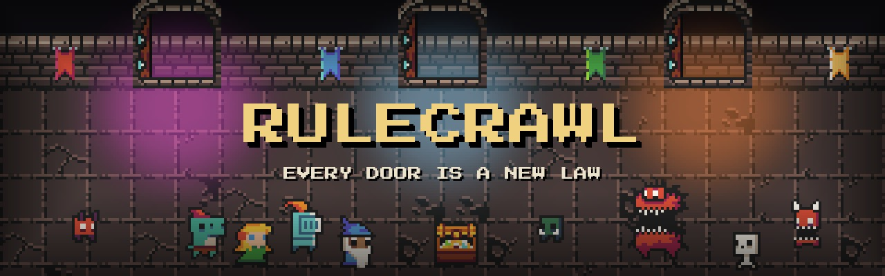
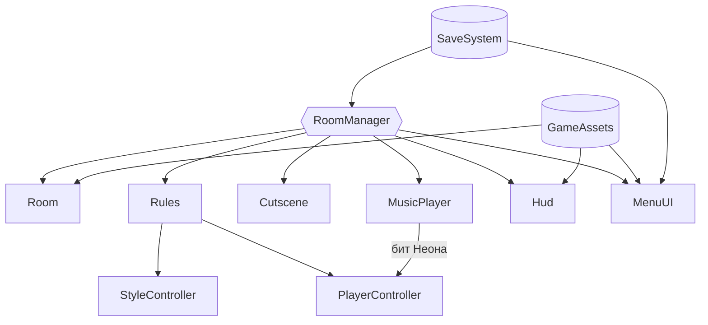

<div align="center">



<h1>RULECRAWL</h1>

<p><b>Пиксельный рогалик, в котором каждая дверь меняет законы игры</b></p>

<p><i>«Каждая дверь — новый закон.»</i></p>

<p>


<a href="https://kyomutenshi.itch.io/rulecrawl"></a>
</p>

<p>
<a href="#об-игре">Об игре</a> ·
<a href="#быстрый-старт">Быстрый старт</a> ·
<a href="#возможности">Возможности</a> ·
<a href="#управление">Управление</a> ·
<a href="#сборка">Сборка</a> ·
<a href="#архитектура">Архитектура</a> ·
<a href="#сторонние-ассеты">Ассеты</a>
</p>

</div>

---

## Об игре

Год назад пропала Амелия, сестра Адама. В ночь, когда её старая консоль включилась сама, Адама затянуло в игру. Здесь за каждой дверью Система меняет сам закон: механику, цвет, свет и музыку. В одной комнате пол превращается в лаву, в другой стрелять можно только стоя на месте, в третьей двигаться можно только в такт музыке. Рядом — фея-навигатор Пикси, в конце — Администратор, который переписывает правила прямо во время боя. Смерть возвращает в самое начало.

```text
Прихожая  →  комнаты этажа (выбор из двух дверей)  →  босс этажа  →  …  →  Администратор
                     └─ портал → Версия 1.0 → Король слизней ─┘
                     └─ портал → Глубинные пещеры → Ледяной страж → Демон-слизень ─┘
```

В стенах прячутся трещины-баги. За ними — повреждённые сохранения Амелии: комнаты из настоящего мира. Три сохранения, три концовки.

> `Roguelike-Prototype` — рабочее название репозитория, а не название игры.

| | |
|---|---|
| **Жанр** | Roguelite, top-down shooter |
| **Движок** | Unity 6 (6000.3.8f1), Universal Render Pipeline 2D |
| **Платформа** | Windows, macOS, браузер (и на телефоне) |
| **Языки** | Русский, English, 中文, Español |
| **Разработчик** | Piperite Games |
| **Играть** | [kyomutenshi.itch.io/rulecrawl](https://kyomutenshi.itch.io/rulecrawl) |

## Быстрый старт

> Нужны **Unity 6000.3.8f1** (через Unity Hub) и сторонние ассеты из раздела [ниже](#сторонние-ассеты). Без них в сцене не будет спрайтов, эффектов и музыки.

1. Склонируйте репозиторий:
   ```bash
   git clone https://github.com/KyomuTenshi/Roguelike-Prototype.git
   ```
2. Положите каждый пак ассетов в `Assets/_ThirdParty/` под именем папки из таблицы.
3. В Unity Hub нажмите **Add** → **Add project from disk** и выберите папку репозитория.
4. Откройте `Assets/_Project/Scenes/Game.unity` и нажмите **Play**.

> Сцена ссылается на ассеты по GUID из `.meta`-файлов, а `.meta` сторонних паков в репозиторий не входят. У заново скачанных паков GUID будут другими, поэтому часть ссылок в компоненте `GameAssets` на объекте `Game` придётся назначить вручную. Код от этого не зависит и открывается сразу.

> Если ссылки на паки Modern tiles или геймпада потерялись, `GameAssets` сам находит их по имени файла. Настройки импорта эффектов, кнопок геймпада и поз персонажей (одиночный спрайт, без сглаживания и сжатия) и музыки (сжатие в памяти, Vorbis не выше 60 %, а в веб-сборке 30 % — меньше памяти и меньше загрузка) редактор выставляет сам при открытии проекта; вручную — **Tools → RULECRAWL → Fix third-party imports**.

## Возможности

- **15 законов.** Склеп, Нуар, Ледяная пещера, Зеркальный зал, Сад пацифиста, Ретро, Лавовый зал, Сокровищница, Перевёрнутая, Неон, Пульт, Гравитация (всё тянет к центру), Стоп-кадр (мир движется, только когда движешься ты), Инфляция (выстрел стоит монету, но бьёт вдвое сильнее) и Зал рикошетов (все снаряды отскакивают) — у каждого своя механика, пост-обработка, свет и музыка.
- **Четыре героя.** Эльф с луком, Рыцарь с мечом, отбивающим снаряды, Волшебница с заряжаемой сферой и телепортом, Ящер с ядовитыми ножами. Трое открываются по ходу игры.
- **Четыре режима.** Забег, Ежедневный (один сид на всех), Хаос (закон меняется каждые 12 секунд) и Бесконечный.
- **Реликвии и комбо.** 84 реликвии и 42 комбинации из пар реликвий: урон по условию (дальние цели, ближний бой, стоя или на бегу), эффекты выстрела (цепная молния, метка, призрачные стрелы, эхо, очереди), защита (уклонение, отражение, 1-UP), экономика (магнит, копилка, купон, инвестор) и реликвии под законы и миры. Реликвии для стрельбы и рывка выпадают только героям, которым они пригодятся. Плюс неизвестные колбы, которые в каждом забеге выглядят по-новому.
- **Баланс от силы героя.** Здоровье врагов и боссов растёт с глубиной и с числом собранных реликвий, со второго этажа враги бьют на целое сердце, сундук после зачистки выпадает не всегда, колбы дают проценты, а не плоские прибавки.
- **Проклятия.** Стеклянное сердце, Ярость, Двойной закон, Аскет — сложнее, но больше очков.
- **Враги.** Бегуны, стрелки и камикадзе, а глубже — таранщики (разгоняются и врезаются в стены), стражи со щитом (бить сбоку, сзади или когда страж опускает щит; от ударов щит ломается), некроманты-призыватели и бесы-телепортёры. Атаки предупреждают вспышкой и значком «!». У золотых элиток есть особенность: быстрый, взрывной, лекарь или под щитом.
- **Активный предмет.** Слот на `Q` (`RB` / `R1`, круглая кнопка на телефоне), заряжается за зачищенные комнаты: бомба (вскрывает трещины), ледяной кристалл, свиток телепорта, зелье, барьер, гнев Системы, разгон. Забег начинается с бомбой, остальные выпадают в сундуках и продаются в лавке.
- **Боссы.** На первом этаже Огр или Вождь в маске, на втором Гнилой великан или Архидемон, Администратор в финале. В мирах-развилках — Король слизней, Ледяной страж и Демон-слизень, у каждого вторая фаза и своя музыка. Глубже в бой иногда ведёт чемпион — большой и очень живучий монстр в короне.
- **Миры-развилки.** На первых этажах одна из дверей — портал. «Версия 1.0» — мир в палитре Game Boy с 8-битной музыкой и своими монстрами. «Глубинные пещеры» — ледяное и огненное ядро мира, единственное место с тайлами RPG Worlds: Caves. Миры можно пропустить.
- **Интерактив.** Ящики, бочки и кристаллы ломаются (монеты и сердца внутри), ледяные кристаллы замораживают монстров, магма взрывается. Шипы-ловушки, рычаги и тайники, вагонетка на рельсах давит врагов, факелы гаснут от выстрела.
- **Персонажи.** Фея Пикси подсказывает, в комнатах иногда встречаются застрявшие игроки: с ними можно поговорить (`E`, `Y` / `△` или кнопка «Говорить»), каждый что-то дарит, а при новых встречах в следующих забегах рассказывает дальше свою часть истории.
- **Процедурные комнаты.** Шесть комнат на этаже, боевые комнаты больше (до 34×20 клеток) и собираются заново в каждом забеге, одинаково для одного сида.
- **Особые комнаты.** Лавка, алтарь и фонтан, а ещё Испытание (три волны и реликвия), Тихий зал (засада в центре), Тайник (три сундука, один — мимик) и гача-терминал [SYSTEM].
- **Случайность.** Порталы в миры, тайные трещины и персонажи появляются не в каждом забеге. Иногда в обычную комнату сбегает монстр из ещё не открытого мира: большой, светится цветом своего мира и оставляет след. После зачистки в боковой стене можно найти едва заметную трещину, через которую он пришёл, — она ведёт в его мир. Боссы миров никогда не покидают своих арен.
- **Музыка миров.** В «Версии 1.0» и в пещерах у каждой комнаты свой трек. У гача-терминала своя тема (Port Town), сохранение открывается короткой мелодией Peaceful Night, а воскрешение 1-UP — джинглом Never Give Up.
- **Неон в такт.** Пять треков с измеренным темпом. Ходить можно всегда, но направление, нажатое в удар музыки, даёт прыжок и «грув»: каждое попадание подряд ускоряет героя (до ×4), нажатие мимо такта сбивает ритм. Враги в Неоне медленнее. Ритм учитывает задержку звука браузера, а если музыка всё равно слышна позже (например, в Bluetooth-наушниках), её можно подстроить: Настройки → Дополнительно → «Сдвиг ритма».
- **Сюжет-исекай.** Пролог, три сохранения Амелии, катсцены на движке и три концовки — их можно пересмотреть в кодексе.
- **Карта этажа.** Все двери до босса решаются в начале этажа, карта на `Tab` показывает путь целиком: можно спланировать маршрут через лавку, испытание или портал.
- **Мета-прогресс.** 20 достижений, история последних забегов, пул реликвий открывается постепенно: в начале 40, остальные — за пройденные забеги и достижения.
- **Ощущение удара.** Короткая пауза кадра при сильных ударах и критах, замедление на последнем враге и на смерти босса, иконка реликвии над героем, когда она срабатывает. Числа урона — по желанию в настройках.
- **Игра в браузере на телефоне.** Веб-версию можно открыть на iPhone или Android — включается сенсорное управление (стики и кнопки, см. [Управление](#управление)). По желанию автострельба по ближайшему врагу; её нет в законах, где выстрел вредит (лечит врагов, стоит монету, будит стражу). В вертикальном положении страница просит повернуть телефон, а когда браузер уходит в фон, игра замирает и сохраняется. Подсказки Пикси и правила говорят о кнопках на экране.
- **Геймпад.** Подсказки сами переключаются на кнопки геймпада, как только им пользуются: в паузе, над предметами и на плашке активного предмета. Кнопки рисуются в стиле Xbox, PlayStation или Switch — по подключённому контроллеру, меню и кодекс листаются стиком и `LB` / `RB`.
- **Эффекты.** Значки над врагами перед атакой, корона чемпиона, «COMPLETE» после испытания, «GAME OVER» при смерти, «LEVEL UP» за достижение, пульс при последней половинке сердца, ноты в Неоне, своя вспышка у каждого активного предмета.
- **Кодекс.** Открытые законы, реликвии и комбо (постранично), пролог, сохранения, концовки, достижения и история забегов.
- **Пасхалка.** Классическая комбинация ↑ ↑ ↓ ↓ ← → ← → B A один раз за забег.

## Управление

| Действие | Клавиатура и мышь | Геймпад |
|---|---|---|
| Движение | `W` `A` `S` `D` или стрелки | Левый стик |
| Прицел | Мышь | Правый стик (сразу и атакует) |
| Атака | `ЛКМ` или `Space` | `RT` / `R2` |
| Рывок (если есть) | `Shift` или `ПКМ` | `A` / `✕` или `LT` / `L2` |
| Активный предмет | `Q` | `RB` / `R1` |
| Карта этажа | `Tab` или `M` | `Select` / `Share` |
| Поговорить / использовать | `E` | `Y` / `△` |
| Пауза | `Esc` или `P` | `Start` |
| Полноэкранный режим | `F11` или `Alt + Enter` (на Mac — `Option + Enter`) | — |
| Листать катсцену / пропустить | любая клавиша / `Esc` | `A` / `Start` |

Рывок, активный предмет и «говорить» переназначаются в **Настройки → Дополнительно**: нажми строку, потом нужную клавишу или кнопку геймпада.

**На телефоне (в браузере):** левая половина экрана — движение, правая — прицел и стрельба (удерживай). Кнопки справа: рывок, активный предмет, «говорить»; под счётом — пауза и карта. В катсцене тап листает, «Пропустить ›» в углу — пропускает. В настройках — автострельба и размер кнопок.

В браузере полноэкранный режим включается в настройках игры или кнопкой полного экрана под игрой на itch.io. В Chrome и Edge `Esc` в полноэкранном режиме ставит паузу, а выйти из полного экрана можно, удерживая `Esc`. В Safari и Firefox `Esc` выводит из полного экрана — игра тогда встаёт на паузу, а «Продолжить» возвращает полный экран.

## Сборка

Собирается через **File → Build Profiles**, в сборку входит одна сцена `Assets/_Project/Scenes/Game.unity`. Настройки плеера для всех платформ уже сохранены в проекте.

| Платформа | Что важно |
|---|---|
| Windows | Нужен модуль **Windows Build Support (Mono)** в Unity Hub |
| macOS | Apple silicon + Intel 64-bit. Приложение не подписано: первый запуск — правый клик → **Открыть** |
| Web | WebGL Template — **RULECRAWL**: игра растягивается на всю страницу, свой экран загрузки, на телефоне — сенсорное управление и просьба повернуть экран. Сжатие Brotli с запасным распаковщиком — работает на любом хостинге, включая itch.io |

Отдельных сборок под iOS и Android нет: на телефоне играют через браузер.

## Архитектура

Вся сцена — одна: комнаты, интерфейс и эффекты строятся из кода во время игры, спрайты нарезаются из листов ассетов по координатам.



| Компонент | Ответственность |
|---|---|
| `RoomManager` | Забег: этажи, выбор дверей, цели комнат, лавка и алтарь, тайные комнаты, концовки; `RoomVariants` — испытание, засада, тайник, гача-терминал |
| `PlayerController` | Герой и его оружие; `PlayerRelics` — эффекты реликвий и комбо через небольшие хуки (урон, выстрел, попадание, удар по герою, убийство, рывок); `PlayerActive` — активный предмет |
| `Enemy` | Поведение врагов; `EnemyKinds` — таранщик, страж, призыватель, телепортёр, предупреждения атак и особенности элиток |
| `DebugMenu` | Меню разработчика на `F1` (только редактор и development-сборки): бессмертие, реликвии, враги, законы, переход в любую комнату |
| `RoomMap` / `RoomVariants` / `RoomWorlds` / `RoomStory` / `RoomSpecials` / `RoomMusic` | Части `RoomManager`: план этажа и карта, новые типы комнат, миры, сюжет и катсцены, особые комнаты, музыка |
| `Juice` | Пауза кадра, замедление, вспышки, числа урона |
| `Achievements` / `Binds` | Достижения и открытие реликвий; переназначаемые клавиши и кнопки геймпада, подсказки клавиатуры, геймпада или сенсора по последнему вводу |
| `TouchControls` / `MobilePlatform` | Сенсорные стики и кнопки для браузера на телефоне; сохранение, когда браузер уходит в фон |
| `ScreenMode` + `RulecrawlWeb.jslib` | Полный экран на всех платформах; в браузере — пауза при выходе из полного экрана по `Esc`, возврат по «Продолжить» и задержка звука для ритма Неона |
| `Room` | Комната из ASCII-раскладки и одной из тем (подземелье, классика, пещера, Ретро, интерьер): пол, стены, двери, декор, лава, трещина в стене |
| `Rules` | Текущий закон и его флаги, которые читают игрок, враги и камера |
| `StyleController` | Пост-обработка, свет и цвет камеры для каждого закона |
| `MusicPlayer` | Кроссфейд, точки петель, варианты треков для одной комнаты, бит из позиции трека с учётом задержки звука, джинглы поверх музыки |
| `Cutscene` | Полосы, субтитры с печатью, камера-«тележка», актёры с ходьбой в четыре стороны |
| `GameAssets` | Все ссылки на ассеты; нарезка UI, иконок, подсказок клавиш и кнопок геймпада, интерьеров, поз персонажей, тайлов пещер и листов SGQ во время игры |
| `Loc` / `Strings` | Таблица строк на четыре языка, смена языка без перезапуска |
| `SaveSystem` | Прогресс, рекорды, открытия кодекса, воспоминания и концовки |

**Ключевые решения**

- Частицы эффектов берутся из общего пула, а не создаются заново: в плотном бою с кольцами снарядов это сотни объектов в секунду.
- Комнаты описаны ASCII-раскладками, а боевые раскладки собираются заново в каждом забеге.
- Случайность забега идёт через собственный генератор `RunRandom` с сидом. В каждой комнате он начинается заново от сида, шага и самой комнаты, поэтому двери, сундуки, элитки и награды в Ежедневном забеге совпадают у всех, кто идёт тем же путём, — сколько бы сундуков ни открыли раньше.
- Звуковые эффекты синтезируются в коде, а не загружаются из файлов.

<details>
<summary><b>Структура проекта</b></summary>
<br>

```text
Assets/
├── _Project/
│   ├── Editor/                 # импорт пиксель-арта, настройки сторонних текстур и музыки
│   ├── Plugins/WebGL/          # мостик игры к странице (полный экран, задержка звука)
│   ├── Input/                  # Input Actions
│   ├── Materials/              # инверсия экрана (Зеркальный зал)
│   ├── Prefabs/                # точечный 2D-свет
│   ├── Scenes/                 # Game.unity
│   ├── Scripts/
│   │   ├── Core/               # GameAssets, Localization, Rules
│   │   ├── Data/               # Audio, Rooms, Run, Save
│   │   ├── Gameplay/           # Camera, Combat, Enemies, Interactive, Items, Narrative, Player, Rooms
│   │   ├── Systems/            # Audio, Progress, SaveSystem, Visuals
│   │   ├── UI/                 # Hud, MenuUI, UiKit, Effects
│   │   └── Utils/              # Fx, Gfx, ScreenMode, RunRandom…
│   ├── Shaders/                # InvertScreen
│   └── UI/                     # шрифты, спрайты интерфейса, иконка
├── _ThirdParty/                # сторонние ассеты, в репозиторий не входят
├── Settings/                   # URP 2D, профиль Volume
└── WebGLTemplates/RULECRAWL/   # шаблон страницы для браузера
```

</details>

## Стек

| | |
|---|---|
| **Движок** | Unity 6000.3.8f1 |
| **Язык** | C# (namespace `RulesShift`) |
| **Рендер** | Universal Render Pipeline 17.3.0, 2D Renderer, Pixel Perfect Camera 384 × 216 |
| **Ввод** | Input System 1.18.0 (клавиатура, мышь, геймпад, сенсорный экран) |
| **Интерфейс** | uGUI 2.0.0, собирается из кода |
| **Шрифты** | [Press Start 2P](https://fonts.google.com/specimen/Press+Start+2P) — CodeMan38, [Handjet](https://github.com/rosettatype/handjet) — Rosetta Type, [ZCOOL QingKe HuangYou](https://fonts.google.com/specimen/ZCOOL+QingKe+HuangYou) — ZCOOL; все под SIL OFL 1.1, тексты лицензий лежат рядом со шрифтами в `Assets/_Project/UI/Fonts` |

Остальные пакеты — в [`Packages/manifest.json`](Packages/manifest.json).

## Сторонние ассеты

Папка `Assets/_ThirdParty/` не хранится в репозитории: это сторонние ассеты со своими лицензиями, их нужно скачать отдельно.

| Ассет | Папка в `Assets/_ThirdParty/` | Для чего | Лицензия |
|---|---|---|---|
| [DungeonTileset II](https://0x72.itch.io/dungeontileset-ii) — 0x72 | `0x72_DungeonTilesetII_v1.7` | Подземелье, герои, враги | CC0 |
| [16x16 Dungeon Tileset](https://0x72.itch.io/16x16-dungeon-tileset) — 0x72 | `0x72_16x16DungeonTileset.v5` | «Другой мир» второго этажа | CC0 |
| [Modern tiles (free)](https://limezu.itch.io/moderninteriors) — LimeZu | `Modern tiles_Free` | Тайные комнаты, Адам и Амелия (ходьба, сидя за столом, с телефоном), их друзья Алекс и Боб, гача-терминал | Только некоммерческое |
| [Dark Ages UI](https://hypnobius.itch.io/dark-ages-ui) — Hypnobius | `DarkAgesUi_v1.0` | Панели, кнопки, полосы | По странице автора |
| [Raven Fantasy Icons (free)](https://clockworkraven.itch.io/raven-fantasy-icons) — Clockwork Raven | `Free - Raven Fantasy Icons` | Иконки реликвий | Только некоммерческое |
| [Gamepad UI](https://greatdocbrown.itch.io/gamepad-ui) — GreatDocBrown | `gdb-gamepad-2(all)` | Подсказки клавиатуры и геймпада (Xbox, PlayStation, Switch) | CC0 |
| [Super Pixel Effects Gigapack (free)](https://untiedgames.itch.io/super-pixel-effects-gigapack) — untiedgames | `Super Pixel Effects Gigapack (Free Version)` | Эффекты | С указанием автора |
| [16-Bit Fantasy & Adventure Music](https://xdeviruchi.itch.io/16-bit-fantasy-adventure-music-pack) — xDeviruchi | `xDeviruchi - 16 bit Fantasy & Adventure (2025)` | Музыка | «Original music by Marllon Silva (xDeviruchi)» |
| [Music Pack for Fast-Paced Games (free)](https://magory.itch.io/music-pack-for-fast-paced-games) — Tomasz Kucza | `fastpaced-music-pack-FREE-OGG` | Музыка Неона | CC BY 4.0 |
| [8-Bit Fantasy & Adventure Music](https://xdeviruchi.itch.io/8-bit-fantasy-adventure-music-pack) — xDeviruchi | `xDeviruchi - 8-bit Fantasy  & Adventure Music (2021)` | Музыка «Ретро», «Пульта», фонтана | «Original music by Marllon Silva (xDeviruchi)» |
| [High Quality 16-bit RPG Music](https://hydrogene.itch.io/high-quality-16-bit-music) — HydroGene | `28 High Quality 16-bit RPG Music` | Музыка законов, комнат, боссов и кодекса | CC0 |
| [Boss: Demon Slime (free)](https://chierit.itch.io/boss-demon-slime) — chierit | `boss_demon_slime_FREE_v1.0` | Демон-слизень, босс «Глубинных пещер» | CC BY 4.0 |
| [Boss: Frost Guardian (free)](https://chierit.itch.io/boss-frost-guardian) — chierit | `Frost_Guardian_FREE_v1.0` | Ледяной страж, босс «Глубинных пещер» | CC BY 4.0 |
| [Super Gameboy Quest: Dungeons pack](https://toadzilla.itch.io/dungeons-pack) — Toadzilla | `SGQ_Dungeon` | Тайлы, пропсы и предметы «Ретро» | С указанием автора и ссылкой на пак |
| [Super Gameboy Quest: Enemies pack](https://toadzilla.itch.io/enemies-pack) — Toadzilla | `SGQ_Enemies` | Монстры «Ретро», Король слизней | С указанием автора и ссылкой на пак |
| [RPG Worlds: Caves](https://szadiart.itch.io/rpg-worlds-ca) — Szadiart | `RPGW_Caves_v2` | Мир «Глубинные пещеры»: его комнаты и арены Ледяного стража и Демона-слизня | Свободно, указание автора по желанию |

Все авторы перечислены в игре: **Главное меню → Об игре**.

---

<div align="center">
<sub>Сделано <a href="https://github.com/KyomuTenshi">KyomuTenshi</a> · Piperite Games</sub>
</div>
